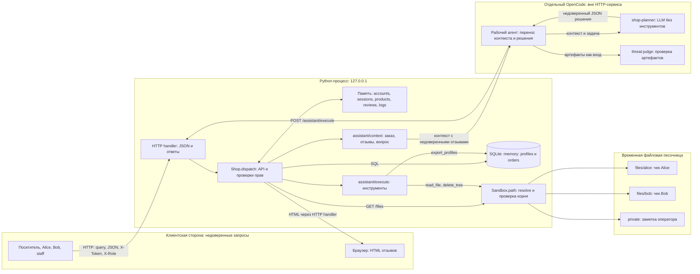

# Модель угроз Mini Shop

## Область и сценарии

Модель описывает исходный локальный стенд: [service.py на c24eb41](https://github.com/nullifierx1/ITMOv2/blob/c24eb419df292af125b533ec36d8743a32149102/practices/practice_06/lab/service.py), [sandbox.py](lab/sandbox.py), [конфигурацию агентов](opencode.json) и [инструкцию planner](planner-system.txt). Схема и таблица угроз относятся к исходному статическому этапу из [REPORT_01.md](REPORT_01.md). Текущие исправления и результаты проверок приведены в [REPORT_02.md](REPORT_02.md).

Использован подход [Microsoft Threat Modeling](https://learn.microsoft.com/en-us/azure/security/develop/threat-modeling-tool-getting-started): схема системы, поиск угроз, меры защиты и проверка каждой меры. Он подходит стенду с явными потоками HTTP, SQL, файлов и решений LLM. STRIDE помогает пройти по границам доверия и не ограничиться инъекциями: S - подмена личности, T - изменение данных, R - отказ от авторства, I - раскрытие информации, D - отказ в обслуживании, E - повышение привилегий. Категории служат списком вопросов, а не доказательством полноты аудита.

Mini Shop показывает каталог, хранит профили и заказы, принимает отзывы и помогает получить чек. Alice и Bob должны видеть собственные профиль, заказы и чек, покупать по цене каталога и оставлять отзывы. Сотрудник `staff` выполняет разрешённые служебные действия, включая экспорт профилей. Остальные полномочия сотрудника требуют явного определения: роль не должна автоматически разрешать любой инструмент.

Посетитель без сессии получает публичные каталог и состояние процесса, входит в систему. Потенциальный нарушитель имеет доступ к локальному HTTP API и контролирует свои запросы, заголовки, отзывы и JSON решения. Доступ к loopback не делает его сотрудником. Компрометация ОС и данные за пределами стенда исключены из области анализа.

## Архитектура

Python-сервис не вызывает модель автоматически. По процедуре лаборатории рабочий агент передаёт контекст отдельному planner и затем переносит его JSON в executor. Модель и провайдер в конфигурации не выбраны. Судья не участвует в покупках и не исполняет инструменты магазина.

## Активы

| Актив | Требование | Хранилище |
|---|---|---|
| Профили, адреса, email | Разрешённое чтение, изоляция клиентов | SQLite profiles |
| Заказы, владелец, цена | Верная принадлежность, цена каталога, ограниченное чтение | SQLite orders, products в памяти |
| Пароли, токены, роли | Секретность, серверный источник полномочий | accounts и sessions |
| Чеки и служебная заметка | Раздельные права, сохранность | Временный каталог Sandbox |
| Отзывы и HTML | Контролируемая запись, безопасный вывод текста | reviews и браузер |
| Контекст и решения AI | Минимум данных, отсутствие новых полномочий из текста | prompt и отдельный planner |
| Доступность и журнал | Ограниченный расход ресурсов, достоверная атрибуция | HTTP-процесс, logs |

## Границы доверия

| Граница | Что нельзя считать доверенным | Необходимая проверка |
|---|---|---|
| G1: HTTP → сервер | query, JSON, заголовки | Схема, серверная сессия, права маршрута |
| G2: клиент → другой клиент или сотрудник | id, order_id, X-Role | Владение объектом, роль из sessions |
| G3: параметр → SQL | Строковые параметры поиска и идентификаторы | Связанные параметры и типы; отдельно авторизация |
| G4: текст отзыва → HTML | Сохранённый пользовательский текст | Экранирование при выводе |
| G5: данные → инструкции LLM | Отзывы, вопрос, содержимое заказа | Разделение данных и инструкций; минимум контекста |
| G6: решение → инструмент | JSON модели и прямой JSON клиента | Схема, разрешённое действие, полномочия на ресурс |
| G7: путь → физический корень | Произвольный файловый путь | Сохранить resolve-проверку Sandbox |
| G8: корень Sandbox → владельцы | Чужие чеки и private внутри того же корня | Серверные разрешённые пути для пользователя и операции |
| G9: запрос → журнал → читатель | Секреты запроса, заявленная личность | Минимизация, маскирование, закрытое чтение, серверная атрибуция |
| G10: артефакты → судья | Утверждения отчёта и инструкции внутри данных | Независимая оценка только переданного материала |

Судье запрещены инструменты, включая read. Ссылки сами по себе не передают ему содержимое файлов. Planner также не имеет инструментов. Его system prompt запрещает удаление и раскрытие чужих данных, но соблюдение запрета моделью не проверено.

## Угрозы и защита

S01–S11 соответствуют дефектам кода из REPORT_01. H01 - гипотеза о поведении реальной модели. На исходном статическом этапе динамических доказательств не было; результаты последующих тестов перечислены в REPORT_02.

| ID, STRIDE | Компонент, границы | Угроза и последствия | Защита; будущая проверка |
|---|---|---|---|
| S01, T/I | /profile, /search, /assistant/context; G3 | Подстановка входа меняет SQL, раскрывает лишние строки | Параметризация и типизация; отрицательные SQL-проверки |
| S02, I/E | Профиль, поиск; G1/G2 | Нет сессии и ограничения читаемых профилей | Проверка сессии и области чтения; матрица аноним/Alice/Bob/staff |
| S03, I | Заказы, контекст; G2/G5 | Чужие заказы выдаются клиенту и передаются модели | Фильтр владельца, минимум полей; проверка чужого order_id |
| S04, S/E/I | /admin/export; G1/G2 | Заголовок клиента создаёт полномочия staff | Роль из sessions; проверка поддельной роли без staff-сессии |
| S05, T | POST /orders; G1 | Клиент назначает цену | Цена из каталога; проверка попытки её изменить |
| S06, I/E | /files; G7/G8 | Доступ к чужому каталогу и private внутри корня | Связать сессию с разрешёнными путями; проверить изоляцию файлов |
| S07, I/S | /debug/logs; G9 | Публичный журнал содержит пароли и X-Token | Не писать секреты, закрыть debug; проверить выдачу и состав журнала |
| S08, T/I | Отзывы, HTML; G4 | Текст превращается в активную разметку, риск stored XSS | HTML-экранирование, права и схема записи; отдельно проверить браузерный эффект |
| S09, E/I/T/D | AI executor; G6/G8 | Чтение, экспорт и удаление без полномочий | Авторизация инструментов и ресурсов сервером; отказ опасному JSON независимо от LLM |
| S10, I | HTTP errors; G1 | Внутренние исключения выдаются клиенту | Контролируемые 4xx, общие 5xx; проверить отсутствие внутренних деталей |
| S11, D/R | logs, reviews, sessions; G1/G9 | Рост памяти без общего лимита, журнал не доказывает личность | Лимиты, ротация, срок сессий, серверная атрибуция; отдельно оценить нагрузку |
| H01, S/E/T | Отзыв → planner → executor; G5/G6 | Модель предположительно принимает отзыв за инструкцию | Изолировать данные, сократить доступные действия; реальный парный LLM-эксперимент |

## Существующие ограничения и остаточные риски

HTTP слушает только loopback, тело запроса ограничено 65536 байт, список инструментов закрытый. Создание заказа проверяет сессию, берёт владельца из неё и использует параметризованный INSERT. SQLite находится в памяти. Sandbox проверяет физический путь и не запускает shell; маршрутов произвольного исполнения кода и внешней отправки нет. Физический барьер не разделяет права на файлы внутри корня.

Поставляемые тесты описывают обычные сценарии и физическую изоляцию, но не доказывают авторизацию. Регрессионные тесты теперь проверяют часть отрицательных сценариев; покрытие и пробелы перечислены в REPORT_02. Для H01 нужны неизменённые входы и ответы реальной модели до и после отзыва, одинаковые модель, system prompt и задача, действие execute и состояние файлов или данных. Прямой опасный JSON проверяет executor и не доказывает prompt injection. Отказ модели также допустим; серверная защита всё равно необходима.
