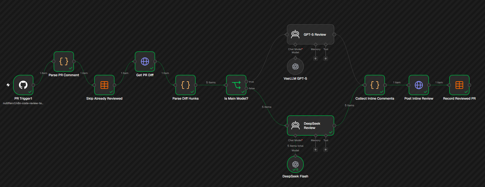
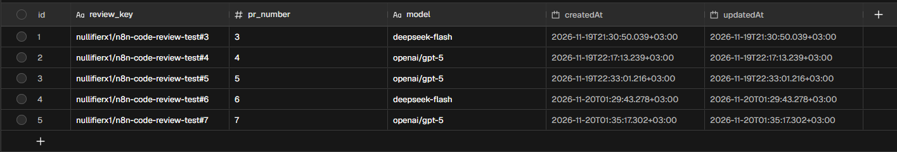

# Практика 7.1. Ассистент для ревью кода в n8n

> Отчёт дополнен результатами тестов на PR №6 и №7. Для критерия дедупликации осталось приложить Execution именно команды `/make_ai_review`.

## Цель

Настроить запуск AI-ревью по командам в комментариях к GitHub PR, подключить вторую модель, сохранять проверенные PR в Data Table и блокировать повторное ревью. Задание со звёздочкой требует привязать комментарии к каждому блоку изменений. Задание и критерии описаны в [README](README.md) и [презентации](presentation.pdf) (страницы 21–24). Проверки проводились в [тестовом репозитории](https://github.com/nullifierx1/n8n-code-review-test).

## Архитектура

[Сценарий в n8n](https://n8n-itmo.cyrweb.ru/workflow/wZQHM4NJmNoRjzSL) · [JSON-экспорт](artifacts/workflow/workflow.json) · [Таблица reviewed_prs](https://n8n-itmo.cyrweb.ru/projects/6NeKLg2x1W0oWnNT/datatables/LjO8YgyJYIZjH6Vb)

1. GitHub Trigger на учебном сервере n8n слушает событие `issue_comment`. Команду оставляют обычным комментарием во вкладке Conversation открытого PR. Само открытие PR в этой версии ревью не запускает.
2. `Parse PR Comment` пропускает только действие `created`, наличие `issue.pull_request`, совпадение с тестовым репозиторием и одну из двух точных команд.
3. `Skip Already Reviewed` проверяет условие `rowNotExists` в таблице `reviewed_prs`. Ключ `owner/repo#number` общий для обеих моделей и всех коммитов в пределах PR.
4. `Get PR Diff` запрашивает текстовый diff GitHub. `Parse Diff Hunks` разбивает его по заголовкам `@@` и передаёт для каждого блока путь файла, строку, сторону diff и текст блока. Для привязки выбирает последнюю добавленную строку (`RIGHT`), а при блоке из одних удалений последнюю удалённую (`LEFT`).
5. `Is Main Model?` направляет `/make_ai_review` в GPT-5 (`openai/gpt-5` через VseLLM ChatGPT), а `/make_other_ai_review` в `deepseek-flash` через DeepSeek API. У провайдеров отдельные credentials.
6. `Collect Inline Comments` собирает массив `comments` с привязками к строкам. Перед публикацией нода сверяет количество блоков и ответов и проверяет, что тексты комментариев заполнены. `Post Inline Review` передаёт его одним запросом `POST /repos/{owner}/{repo}/pulls/{number}/reviews`.
7. После успешной публикации `Record Reviewed PR` сохраняет в таблицу `review_key`, `pr_number` и `model`.

## Проверка на тестовых PR

### Вторая модель и точечные комментарии

В PR №6 команда `/make_other_ai_review` запустила DeepSeek Flash. В Execution парсер передал модели пять блоков diff. Сценарий собрал ответы, опубликовал ревью и записал PR в таблицу. В GitHub опубликовано ревью «AI Inline Code Review · DeepSeek Flash» с отметкой о пяти блоках. [PR №6](https://github.com/nullifierx1/n8n-code-review-test/pull/6)

В PR №7 команда `/make_ai_review` запустила GPT-5. В diff пять блоков, а в GitHub пять точечных комментариев: четыре в `app.py` (строки 9, 34, 46 и 64) и один в `config.py` (строка 14). В одном из них GPT-5 указал, что словари и списки, объявленные как константы, остаются изменяемыми. [Комментарии к изменениям PR №7](https://github.com/nullifierx1/n8n-code-review-test/pull/7/files)

В промежуточных тестах модели публиковали ревью всего diff. GPT-5 отметил опечатки в импорте и имени метода, а DeepSeek предложил обработать ошибку разбора URL. Это примеры разных замечаний из тестовых запусков.

### Запись в Data Table и остановка повторного запуска

В `reviewed_prs` есть запись `nullifierx1/n8n-code-review-test#6` с моделью `deepseek-flash` и запись `nullifierx1/n8n-code-review-test#7` с моделью `openai/gpt-5`.

После ревью GPT-5 в PR №7 отправили `/make_other_ai_review`. Запуск остановился на `Skip Already Reviewed`, до запроса diff и вызова любой модели. Ключ записи общий для обеих команд. [Повторная команда в PR №7](https://github.com/nullifierx1/n8n-code-review-test/pull/7#issuecomment-7082587054)

Для критерия README важно показать остановку именно `/make_ai_review`. В PR №6 эту команду отправили после успешного ревью DeepSeek, и второго ревью в GitHub нет. Для сдачи осталось приложить соответствующий Execution из n8n. [Повторная команда в PR №6](https://github.com/nullifierx1/n8n-code-review-test/pull/6#issuecomment-7024041136)

## Проверка критериев

| Критерий README | Баллы | Что видно в материалах |
| --- | ---: | --- |
| `/make_other_ai_review` запускает вторую модель и публикует результат | 2 | DeepSeek Flash обработал пять блоков и опубликовал ревью в PR №6. |
| Data Table хранит идентификатор проверенного PR | 2 | В `reviewed_prs` видны записи PR №6 и №7. |
| Повторный `/make_ai_review` останавливается до вызова модели | 3 | Для PR №6 есть команда в GitHub. Нужен её Execution. Скриншот PR №7 показывает остановку `/make_other_ai_review`. |
| Точечный комментарий к каждому блоку изменений | 5 | У PR №7 пять комментариев на пять блоков diff. |

По README критерии засчитываются по порядку. На страницах 21–22 презентации запуск при открытии PR идёт перед переходом к ручной команде. Итоговый сценарий слушает `issue_comment`. Событие `pull_request/opened` проверялось в ранней версии.

Для справки сохранены [экспорт до объединения веток](artifacts/workflow/workflow-before-merge.json), [событие открытия PR](artifacts/events/opened-pr-event.json) и [событие удаления комментария](artifacts/events/deleted-comment-event.json).

## Итоги

Проверка PR №6 показала работу второй модели, а PR №7 дал пример точечного ревью на пяти блоках и остановки повторной команды по записи в таблице. Запись создаётся после публикации. При параллельных командах оба запуска могут пройти проверку до первой записи, поскольку проверка и вставка выполняются в разных нодах.
