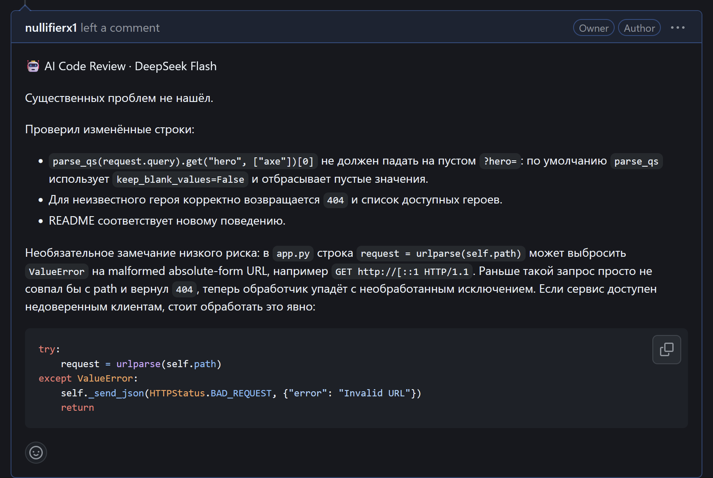
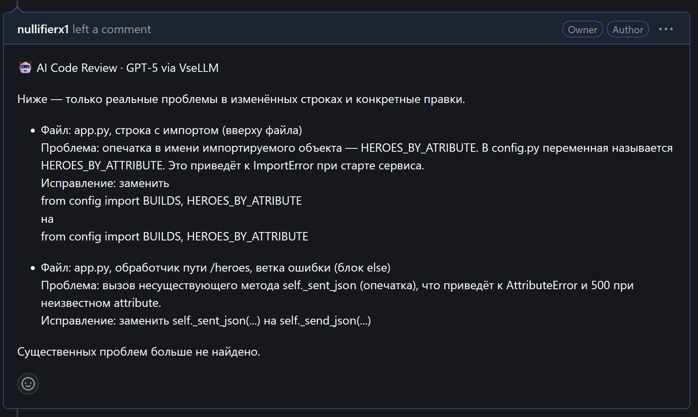
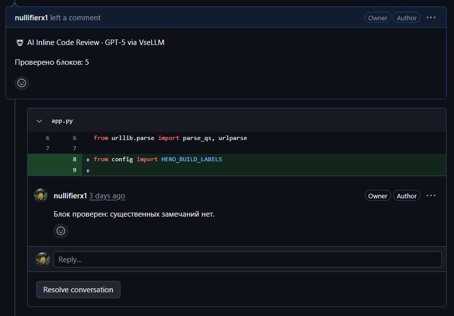
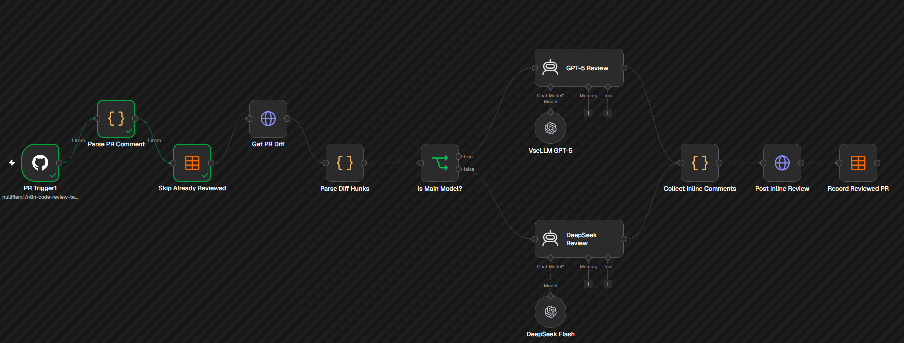
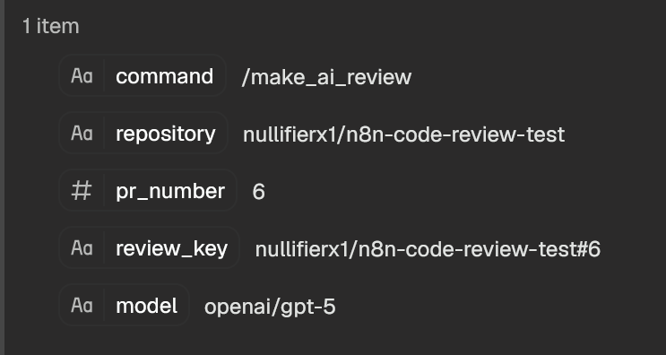
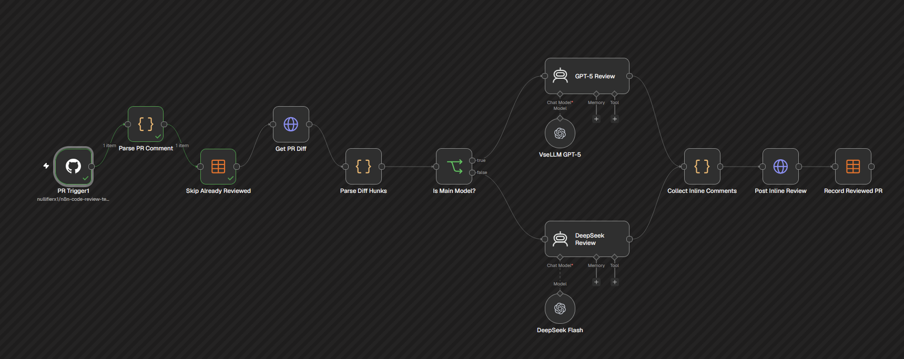

# Практика 7.1. Ассистент для ревью кода в n8n

## Цель

Настроить запуск AI-ревью по командам в комментариях к GitHub PR, подключить вторую модель, сохранять проверенные PR в Data Table и блокировать повторное ревью. Задание со звёздочкой требует привязать комментарии к каждому блоку изменений. Задание и критерии описаны в [README](README.md) и [презентации](presentation.pdf) (страницы 21–24). Проверки проводились в [тестовом репозитории](https://github.com/nullifierx1/n8n-code-review-test).

## Архитектура

[Сценарий в n8n](https://n8n-itmo.cyrweb.ru/workflow/wZQHM4NJmNoRjzSL) · [JSON-экспорт](artifacts/workflow/workflow.json) · [Таблица reviewed_prs](https://n8n-itmo.cyrweb.ru/projects/6NeKLg2x1W0oWnNT/datatables/LjO8YgyJYIZjH6Vb)

1. GitHub Trigger на учебном сервере n8n слушает событие `issue_comment`. Команду оставляют обычным комментарием во вкладке Conversation открытого PR. Само открытие PR в этой версии ревью не запускает.
2. `Parse PR Comment` пропускает только действие `created`, наличие `issue.pull_request`, совпадение с тестовым репозиторием и одну из двух точных команд.
3. `Skip Already Reviewed` проверяет условие `rowNotExists` в таблице `reviewed_prs`. Ключ `owner/repo#number` включает репозиторий и номер PR. Обе команды используют один ключ, потому что таблица отмечает сам PR, независимо от модели и числа коммитов.
4. `Get PR Diff` запрашивает текстовый diff GitHub. `Parse Diff Hunks` разбивает его по заголовкам `@@` и передаёт для каждого блока путь файла, строку, сторону diff и текст блока. Для привязки выбирает последнюю добавленную строку (`RIGHT`), а при блоке из одних удалений последнюю удалённую (`LEFT`).
5. `Is Main Model?` направляет `/make_ai_review` в GPT-5 (`openai/gpt-5` через VseLLM ChatGPT), а `/make_other_ai_review` в `deepseek-flash` через DeepSeek API. У провайдеров отдельные credentials.
6. `Collect Inline Comments` сопоставляет ответы модели с блоками по позиции во входных массивах и собирает `comments` с полями `path`, `line`, `side` и `body`. Перед публикацией нода сверяет количество блоков и ответов и проверяет, что тексты комментариев заполнены. `Post Inline Review` передаёт его одним запросом `POST /repos/{owner}/{repo}/pulls/{number}/reviews`.
7. После успешной публикации `Record Reviewed PR` сохраняет в таблицу `review_key`, `pr_number` и `model`.

## Проверка на тестовых PR

### Ревью до добавления inline-комментариев

Оба скриншота сделаны до перехода на точечное ревью. Тогда модели оставляли один общий комментарий на весь diff. GPT-5 отметил опечатки в импорте и имени метода, а DeepSeek предложил обработать ошибку разбора URL.

### Итоговый запуск с inline-комментариями

В PR №6 команда `/make_other_ai_review` запустила DeepSeek Flash. На скриншоте видно, как пять блоков проходят через модель до публикации и записи в таблицу. Номер PR в кадр не попал. Модель пропустила намеренно внесённые ошибки Python, в том числе ссылки на необъявленные имена. Все пять комментариев при этом опубликованы. [Команда](https://github.com/nullifierx1/n8n-code-review-test/pull/6#issuecomment-7024002506) · [Ревью DeepSeek](https://github.com/nullifierx1/n8n-code-review-test/pull/6#pullrequestreview-5984444406)

В отдельном запуске в PR №7 команда `/make_ai_review` запустила GPT-5. Модель указала на изменяемые словари и списки в `config.py`. В её комментариях к `app.py` намеренно внесённые ошибки тоже остались без замечаний. [Команда](https://github.com/nullifierx1/n8n-code-review-test/pull/7#issuecomment-7024103382) · [Ревью GPT-5](https://github.com/nullifierx1/n8n-code-review-test/pull/7#pullrequestreview-5984505521)

В каждом PR пять блоков diff и пять inline-комментариев во вкладке Files changed. Привязки совпадают в обоих PR: `app.py` на строках 9, 34, 46 и 64, `config.py` на строке 14. [Файлы PR №6](https://github.com/nullifierx1/n8n-code-review-test/pull/6/files) · [Файлы PR №7](https://github.com/nullifierx1/n8n-code-review-test/pull/7/files)

### Запись в Data Table и остановка повторного запуска

В `reviewed_prs` есть запись `nullifierx1/n8n-code-review-test#6` с моделью `deepseek-flash` и запись `nullifierx1/n8n-code-review-test#7` с моделью `openai/gpt-5`.

После ревью GPT-5 в PR №7 отправили `/make_other_ai_review`. Запуск остановился на `Skip Already Reviewed`, до запроса diff и вызова любой модели. Проверка идёт до выбора модели и использует один ключ PR для обеих команд. [Повторная команда в PR №7](https://github.com/nullifierx1/n8n-code-review-test/pull/7#issuecomment-7082587054)

В PR №6 после ревью DeepSeek Flash повторно отправили `/make_ai_review`. В [Execution №5222](https://n8n-itmo.cyrweb.ru/workflow/wZQHM4NJmNoRjzSL/executions/5222) `Parse PR Comment` определила команду, номер PR `6` и ключ `nullifierx1/n8n-code-review-test#6`.

`Skip Already Reviewed` нашла запись в `reviewed_prs` и остановила выполнение. `Get PR Diff`, GPT-5 и `Post Inline Review` не запускались.

## Проверка критериев

| Критерий README | Баллы | Что видно в материалах |
| --- | ---: | --- |
| `/make_other_ai_review` запускает вторую модель и публикует результат | 2 | [Execution DeepSeek](artifacts/evidence/09-deepseek-review-execution.png) и [ревью в PR №6](https://github.com/nullifierx1/n8n-code-review-test/pull/6#pullrequestreview-5984444406). |
| Data Table хранит идентификатор проверенного PR | 2 | [Строки PR №6 и №7 в `reviewed_prs`](artifacts/evidence/10-reviewed-prs-data-table.png). |
| Повторный `/make_ai_review` останавливается до вызова модели | 3 | [Execution №5222](https://n8n-itmo.cyrweb.ru/workflow/wZQHM4NJmNoRjzSL/executions/5222) подтверждает блокировку для PR №6. Видны [команда и номер PR](artifacts/evidence/14-execution-5222-parse-pr-comment-output.png) и [остановка до запроса diff](artifacts/evidence/13-execution-5222-repeat-review-blocked.png). |
| Точечный комментарий к каждому блоку изменений | 5 | По пять inline-комментариев на пять блоков в [PR №6](https://github.com/nullifierx1/n8n-code-review-test/pull/6/files) и [PR №7](https://github.com/nullifierx1/n8n-code-review-test/pull/7/files). |

По README критерии засчитываются по порядку. На страницах 21–22 презентации запуск при открытии PR идёт перед переходом к ручной команде. Итоговый сценарий слушает `issue_comment`. Событие `pull_request/opened` проверялось в ранней версии.

Для справки сохранены [экспорт до объединения веток](artifacts/workflow/workflow-before-merge.json), [событие открытия PR](artifacts/events/opened-pr-event.json) и [событие удаления комментария](artifacts/events/deleted-comment-event.json).

## Итоги

При параллельных командах оба запуска могут пройти проверку до первой записи, поскольку проверка и вставка выполняются в разных нодах. Этот случай не проверялся.
