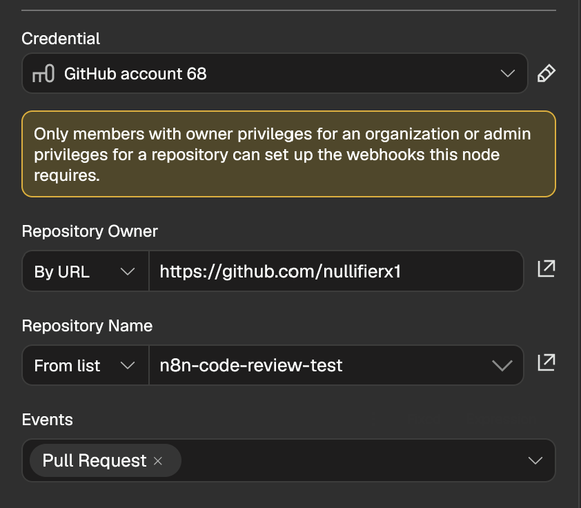
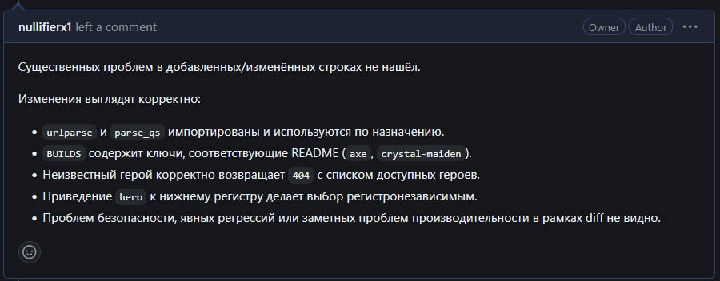
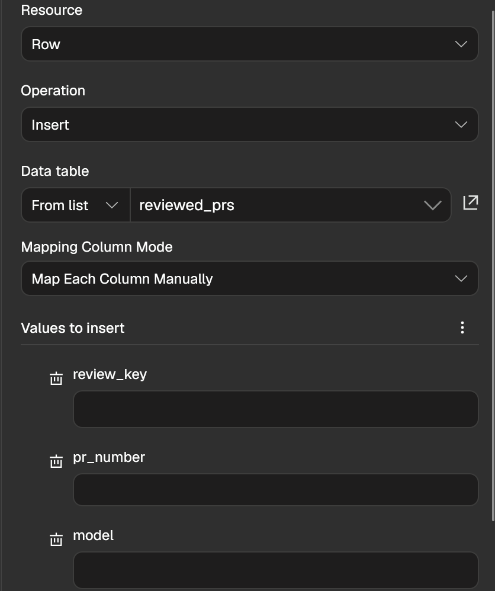
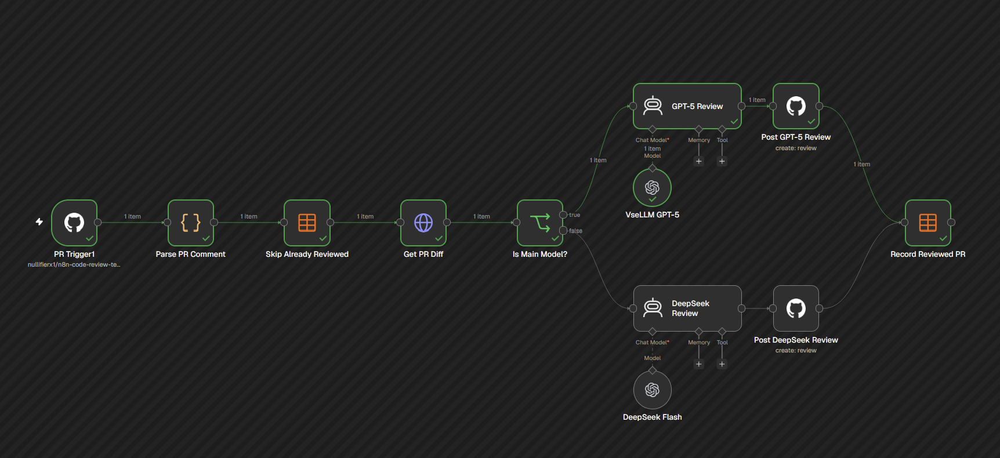
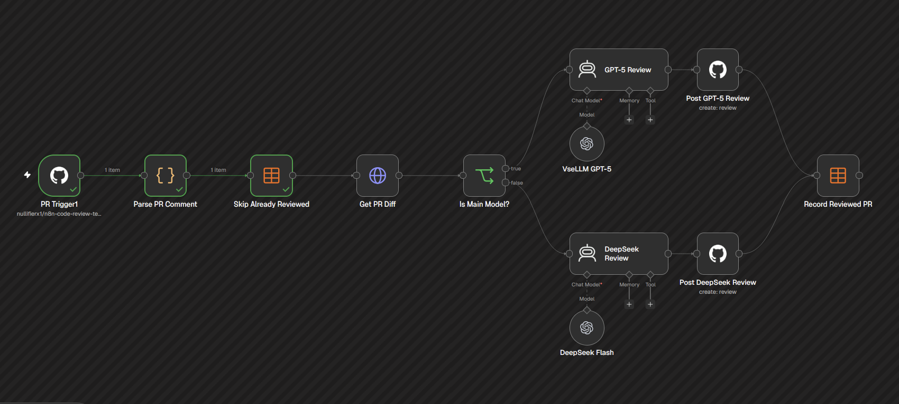
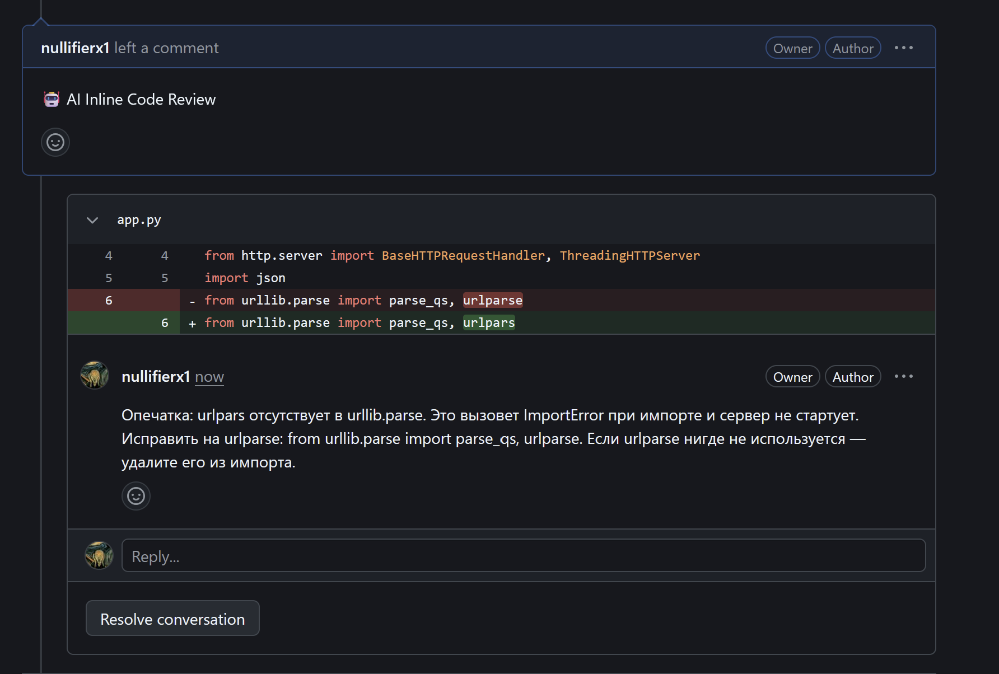

# Практика 7.1. Ассистент для ревью кода в n8n

> Рабочий черновик. Скриншоты показывают промежуточные запуски. Итоговый экспорт ещё предстоит проверить на стенде.

## Цель

Настроить запуск AI-ревью по командам в комментариях к GitHub PR, подключить вторую модель, сохранять проверенные PR в Data Table и блокировать повторное ревью. Задание со звёздочкой требует привязать комментарии к каждому блоку изменений. Задание и критерии описаны в [README](README.md) и [презентации](presentation.pdf) (страницы 21–24). Проверки проводились в [тестовом репозитории](https://github.com/nullifierx1/n8n-code-review-test).

## Архитектура

Итоговая схема приведена в [экспорте workflow](artifacts/workflow/workflow.json).

1. GitHub Trigger на учебном сервере n8n слушает событие `issue_comment`. Команду оставляют обычным комментарием во вкладке Conversation открытого PR. Само открытие PR в этой версии ревью не запускает.
2. `Parse PR Comment` пропускает только действие `created`, наличие `issue.pull_request`, совпадение с тестовым репозиторием и одну из двух точных команд.
3. `Skip Already Reviewed` проверяет условие `rowNotExists` в таблице `reviewed_prs`. Ключ `owner/repo#number` общий для обеих моделей и всех коммитов в пределах PR.
4. `Get PR Diff` запрашивает текстовый diff GitHub. `Parse Diff Hunks` разбивает его по заголовкам `@@` и передаёт для каждого блока путь файла, строку, сторону diff и текст блока. Для привязки выбирает последнюю добавленную строку (`RIGHT`), а при блоке из одних удалений последнюю удалённую (`LEFT`).
5. `Is Main Model?` направляет `/make_ai_review` в GPT-5 (`openai/gpt-5` через VseLLM ChatGPT), а `/make_other_ai_review` в `deepseek-flash` через DeepSeek API. У провайдеров отдельные credentials.
6. `Collect Inline Comments` собирает массив `comments` с привязками к строкам. Перед публикацией нода сверяет количество блоков и ответов и проверяет, что тексты комментариев заполнены. `Post Inline Review` передаёт его одним запросом `POST /repos/{owner}/{repo}/pulls/{number}/reviews`.
7. После успешной публикации `Record Reviewed PR` сохраняет в таблицу `review_key`, `pr_number` и `model`.

## Ход работы

Скриншоты в этом разделе относятся к промежуточным версиям сценария.

### 1. Настроить GitHub Trigger и получить diff

При первой настройке GitHub Trigger не смог создать вебхук из-за прав доступа. После настройки репозитория и токена триггер принял `pull_request/opened` для PR №3, а HTTP Request получил diff с изменениями в `README.md` и `app.py`. Позднее триггер переключили на `issue_comment`. Исторический PR уже закрыт после слияния. [PR №3](https://github.com/nullifierx1/n8n-code-review-test/pull/3)

### 2. Подключить вторую модель

Обе модели публиковали общие комментарии ревью. В приложенных примерах GPT-5 указал на опечатки в имени импорта и метода, а DeepSeek проверил обработку параметра `hero` и предложил обработать ошибку разбора URL.

### 3. Сохранять проверенные PR в Data Table

После публикации нода `Record Reviewed PR` записывает ключ PR, его номер и модель в `reviewed_prs`. На промежуточном запуске GPT-5 видно, что цепочка дошла до этой ноды. Для проверки самой записи нужен отдельный скриншот содержимого таблицы.

### 4. Остановить повторное ревью

Следующий запуск на том же PR остановился на `Skip Already Reviewed` до запроса diff. По журналу разработки второй командой была `/make_other_ai_review`. Там же зафиксировано, что событие `deleted` отфильтровалось до вызова модели.

### 5. Опубликовать комментарий к строке diff

В экспериментальной версии парсер выделил блок `app.py` со строкой 6 на стороне `RIGHT`. Модель указала на ошибку в импорте `urlpars` вместо `urlparse`. Тестовый вызов GitHub Reviews API опубликовал одно замечание у изменённой строки во вкладке Files changed. Затем разбор блоков, выбор модели, сбор комментариев и публикацию объединили в один сценарий для финального теста.

## Проверка критериев

| Критерий | Баллы | Что известно и чего не хватает |
| --- | ---: | --- |
| `/make_other_ai_review` запускает вторую модель и публикует результат | 2 | На скриншоте видно опубликованное ревью DeepSeek промежуточной версии. Для итоговой версии нужен Execution с этой командой и ссылка на PR. |
| Data Table хранит идентификатор проверенного PR | 2 | На скриншотах видны настройки ноды вставки и успешное выполнение этой ноды. Для подтверждения нужна строка с идентификатором в содержимом `reviewed_prs`. |
| Повторный `/make_ai_review` к уже проверенному PR не запускает модель | 3 | На скриншоте видно остановку на `Skip Already Reviewed`. По журналу это была команда DeepSeek после запуска GPT-5. Для точного соответствия критерию нужен Execution, где именно `/make_ai_review` на уже проверенном PR останавливается до вызова модели. |
| Точечные комментарии к каждому блоку изменений | 5 | На скриншоте виден один экспериментальный комментарий к строке. Сквозной тест объединённой версии на PR с несколькими блоками ещё не подтверждён. |

Баллы начисляются по порядку после подтверждения каждого критерия реальным запуском.

Презентация сначала предлагает фильтровать события PR по открытию, а следующим шагом переводит ревью на команду в комментарии. В промежуточном тесте отработал `pull_request/opened`. В текущем JSON настроен только `issue_comment`, поэтому автоматический запуск при открытии относится к ранней версии.

## Доказательства

Для истории сохранены [экспорт до объединения веток](artifacts/workflow/workflow-before-merge.json), [событие открытия PR](artifacts/events/opened-pr-event.json) и [событие удаления комментария](artifacts/events/deleted-comment-event.json). В событиях оставлены только тип, действие, репозиторий, номер PR и текст команды при наличии.

## Итоги

Оба экспорта прошли статическую проверку. В итоговом экспорте 13 нод и 13 связей, в промежуточном 16 нод и 16 связей. Все источники и назначения в `connections` и ссылки на ноды в выражениях существуют. Проверены синтаксис кода и выражений и используемые переменные n8n (`$input`, `$json`, обращения к нодам через `$`). Экспорты сохранены в исходном виде. Credentials представлены ссылками `id` и `name`. В файлах не обнаружены значения токенов, ключей и подписи вебхуков. После импорта может потребоваться заново выбрать credentials и таблицу `reviewed_prs`.

На стенде осталось проверить поле `data` на выходе `Get PR Diff` и убедиться, что каждый комментарий попадает в свой блок. Сценарий сопоставляет ответы с блоками по порядку. Проверку таблицы и запись выполняют разные ноды, поэтому два параллельных запуска могут пройти проверку до первой записи.

### Перед сдачей

- [ ] Добавить ссылку на активный workflow в интерфейсе n8n. Перед тестом проверить, какой сценарий принимает события тестового репозитория.
- [ ] Добавить ссылку на новый открытый тестовый PR с 2–3 отдельными блоками изменений от актуальной ветки `main`.
- [ ] Приложить финальный Execution после `/make_other_ai_review` до `Record Reviewed PR`. Сверить количество подходящих блоков с количеством элементов `comments` и публикацией в GitHub.
- [ ] Приложить скриншот нескольких точечных комментариев в разных блоках во вкладке Files changed.
- [ ] Приложить скриншот содержимого `reviewed_prs` с новой строкой.
- [ ] Приложить Execution для `/make_ai_review` в том же PR с остановкой до вызова модели.
- [ ] Если настройки сценария изменятся во время финального теста, обновить экспорт по протестированной версии.
