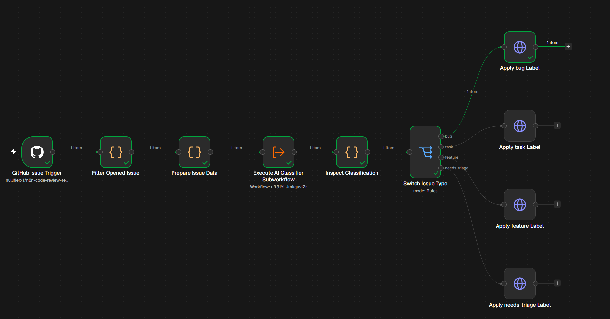
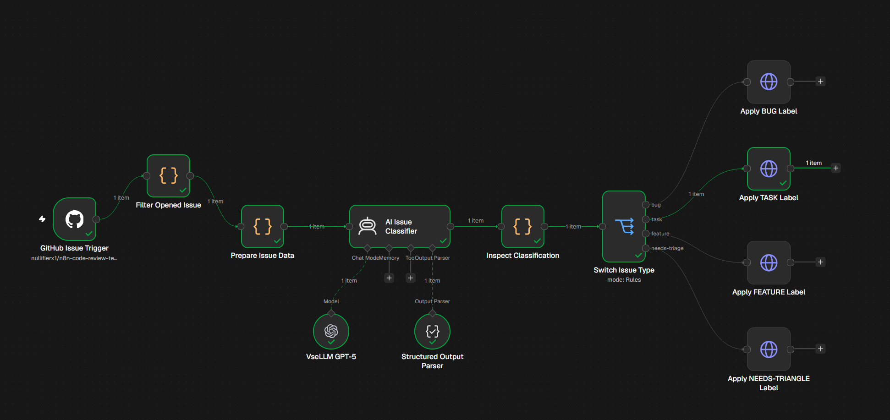
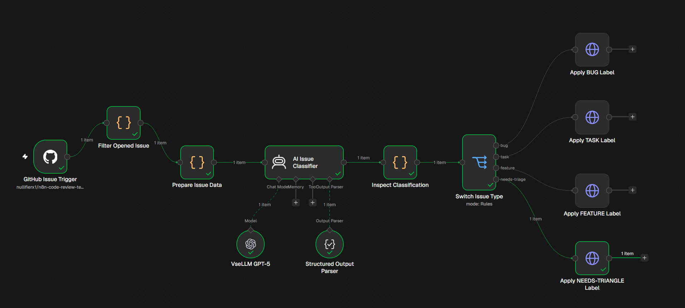
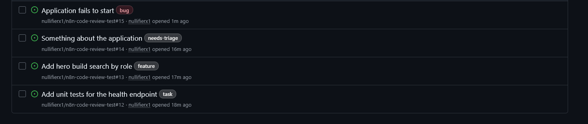
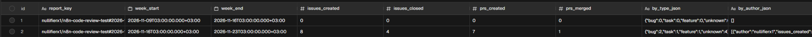

# Практика 7.2. Поддержка пользователя с помощью AI-инструментов

> Рабочий черновик. По Issues есть результаты отдельных запусков, по недельному сценарию есть письма и записи в Data Table. Три JSON-экспорта ещё нужно приложить.

## 1. Цель работы

Настроить в n8n два процесса: назначать лейблы новым GitHub Issues и отправлять недельную сводку через Gmail. Для задания со звёздочкой нужно сохранять сводки в Data Table, сравнивать две недели и добавлять в письмо комментарий модели.

Задание описано в [README](README.md) и [презентации](presentation.pdf) (страницы 13–24).

**Тестовый репозиторий:** https://github.com/nullifierx1/n8n-code-review-test

Ссылки на три сценария собраны в [LINKS.md](artifacts/LINKS.md).

## 2. Используемые инструменты

- **n8n:** выполнение автоматизаций, триггеры, HTTP Request, Data Table, Gmail.
- **GitHub API:** события открытия Issues, присвоение лейблов, выборка недельной статистики.
- **GPT-5 через VseLLM:** классификация Issues и генерация комментария к недельному отчёту.
- **Structured Output Parser:** формат `type` и `confidence`.
- **Gmail OAuth2:** отправка HTML-писем.

В письме недельного отчёта указаны GPT-5 и VseLLM. Точные ID моделей и версии сценариев предстоит сверить по JSON-экспортам.

## 3. Архитектура

В n8n три сценария. Обработчик Issues вызывает дочерний классификатор, недельный отчёт запускается отдельно.

1. `Practice 7.2 - GitHub Issue Handler`: GitHub Trigger → фильтрация `issues.opened` → подготовка данных → Execute Workflow → проверка классификации → Switch → GitHub API (лейблы).
2. `Practice 7.2 - AI Issue Classifier`: Execute Workflow Trigger → GPT-5 + Structured Output Parser → `type`, `confidence`.
3. `Practice 7.2 - Weekly GitHub Report`: Cron `0 9 * * MON` → четыре GitHub API-запроса → Code (агрегация) → Data Table → предыдущая неделя и Δ → Basic LLM Chain → HTML → Gmail.

**Схема основного обработчика:**

**Схема еженедельной статистики:**

## 4. Workflow 1: классификация Issues

### 4.1. Классификация и назначение лейблов

При создании Issue основной workflow считывает заголовок и описание, передаёт их в классификатор, получает категорию `bug` / `task` / `feature` и `confidence`, затем назначает соответствующий лейбл через GitHub API.

### Примеры Issues

| Issue | Результат |
|---|---|
| [#12](https://github.com/nullifierx1/n8n-code-review-test/issues/12) | `task` |
| [#13](https://github.com/nullifierx1/n8n-code-review-test/issues/13) | `feature` |
| [#14](https://github.com/nullifierx1/n8n-code-review-test/issues/14) | `needs-triage` |
| [#15](https://github.com/nullifierx1/n8n-code-review-test/issues/15) | `bug`, через sub-workflow |

На снимках ниже классификатор ещё находится в основном сценарии.

### 4.2. Неоднозначные обращения

Если модель не определяет тип или возвращает `confidence < 0.8`, сценарий должен поставить лейбл `needs-triage` и завершиться без комментария. На приложенном запуске видна ветка `needs-triage`. Для Issue #14 ещё нужен вывод классификатора со значением `confidence` и скриншот страницы Issue.

### 4.3. Вызов дочернего workflow

Классификатор вынесен в отдельный sub-workflow. Основной workflow передаёт `title` и `body`, ожидает результат и продолжает маршрутизацию по `type` и `confidence`.

## 5. Еженедельный GitHub Report

### 5.1. Расписание и данные GitHub

Расписание по ТЗ: понедельник в 09:00 (`0 9 * * MON`). Сценарий делает четыре запроса к GitHub API за прошлую неделю: отдельно для созданных и закрытых Issues, отдельно для созданных и объединённых PR. Code node группирует созданные Issues по типу и автору.

### 5.2. Две тестовые недели

Недельные интервалы были проверены вручную:

| Показатель | 09.11–15.11.2026 | 16.11–22.11.2026 |
|---|---:|---:|
| Создано Issues | 0 | 8 |
| Закрыто Issues | 0 | 4 |
| Создано PR | 0 | 7 |
| Объединено PR | 0 | 1 |

Во вторую неделю `nullifierx1` открыл все восемь Issues. Из них два `bug`, одно `task`, одно `feature` и четыре `unknown`.

**Письмо за неделю 9–15 ноября:**

**Письмо за неделю 16–22 ноября:**

### 5.3. Data Table и предотвращение дубликатов

Таблица `weekly_issue_stats` хранит недельные значения, JSON по типам и авторам. Операция `Upsert` использует `report_key` вида `owner/repo#YYYY-MM-DD` для повторных запусков.

### 5.4. Сравнение недель (Δ)

Сценарий читает предыдущую неделю из Data Table и вычитает её показатели из текущих `Δ = current - previous`.

| Показатель | Предыдущая | Текущая | Δ |
|---|---:|---:|---:|
| Создано Issues | 0 | 8 | +8 |
| Закрыто Issues | 0 | 4 | +4 |
| Создано PR | 0 | 7 | +7 |
| Объединено PR | 0 | 1 | +1 |

### 5.5. AI-комментарий недели

`Basic LLM Chain` получает сводную статистику и изменения Δ, формирует комментарий, который вставляется в HTML-письмо. При отсутствии данных предыдущей недели сценарий показывает `N/A`, не подставляя фиктивные числа.

## 6. Проверка критериев

| Критерий README | Баллы | Что видно в материалах |
|---|---:|---|
| Лейблы `bug`, `task`, `feature` | 2 | Для `bug` и `task` есть скриншоты. Для `feature` в черновике есть ссылка на Issue #13. |
| `needs-triage` при `confidence < 0.8` | 1 | Видна ветка `needs-triage`. Нужны численное значение и страница Issue без комментария. |
| Вызов классификатора через Execute Workflow | 2 | Есть запуск для Issue #15. Нужны вход и выход ноды и результаты остальных веток после выноса классификатора. |
| Cron и четыре запроса | 2 | Есть скриншот запуска запросов. Настройки Cron нужно сверить по экспорту. |
| Группировка по типу и автору | 2 | Разбивка видна в письме. Нужен вывод `Aggregate Weekly Statistics`. |
| HTML-письмо через Gmail | 2 | Есть запуск с Gmail и скриншоты доставленных писем. |
| Запись в Data Table | 1 | Есть запуск Upsert и скриншот двух строк. |
| Δ по предыдущей неделе из Data Table | 2 | В письме видны оба периода и Δ. Нужен вывод чтения таблицы и расчёта. |
| AI-комментарий недели | 2 | Блок виден в письме. Нужен вход и выход `AI Weekly Commentary`. |
| **Максимум по README** | **16** | |

Слайды шире таблицы на 16 баллов. На страницах 18–19 показана ветка `first-time-contributor`: лейбл по `author_association == "NONE"` и приветствие со ссылкой на `CONTRIBUTING.md`. На страницах 22–23 есть дедупликация Issues через `processed_issues` с проверкой повторного открытия. В материалах черновика подтверждений этих веток нет. На странице 16 для обычных типов показаны комментарии с шаблонами и лейбл `feature-request`. README требует лейблы и отдельно оговаривает отсутствие комментария для `needs-triage`. Сверхрезультат на 10 баллов в этом черновике не заявлен.

## 7. Результаты и выводы

На ручных прогонах письмо показало два случая. Когда в таблице нет строки за прошлую неделю, сравнение выводится как `N/A`. Когда строка есть, письмо показывает Δ: +8 созданных Issues, +4 закрытых Issues, +7 созданных PR и +1 объединённый PR. В письме эти числа повторяет AI-комментарий.

## 8. Перед сдачей

- [x] Приложить JSON-экспорты обработчика Issues, дочернего классификатора и недельного отчёта. Сверить версии и ID моделей, проверить файлы на секреты.
- [ ] Приложить скриншоты финальных запусков классификатора и недостающие выводы нод из таблицы выше. Добавить общий снимок Issues с лейблами, если он нужен для проверки.
- [x] Сверить Cron и часовой пояс. Убрать ручную подстановку недели (`manualWeekStart = ''`) перед включением расписания. На приложенном финальном письме видна пометка о ручной подстановке.
- [x] Приложить скриншоты писем и Data Table за две недели, указать ссылки на тестовые Issues.
