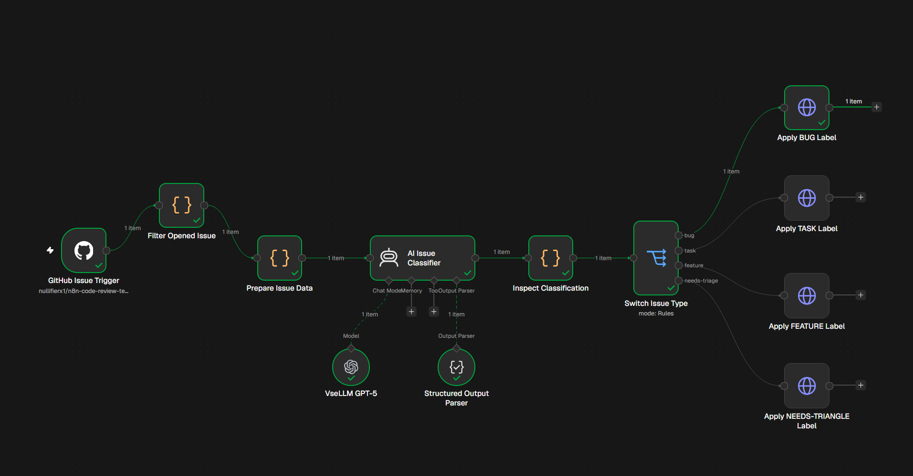
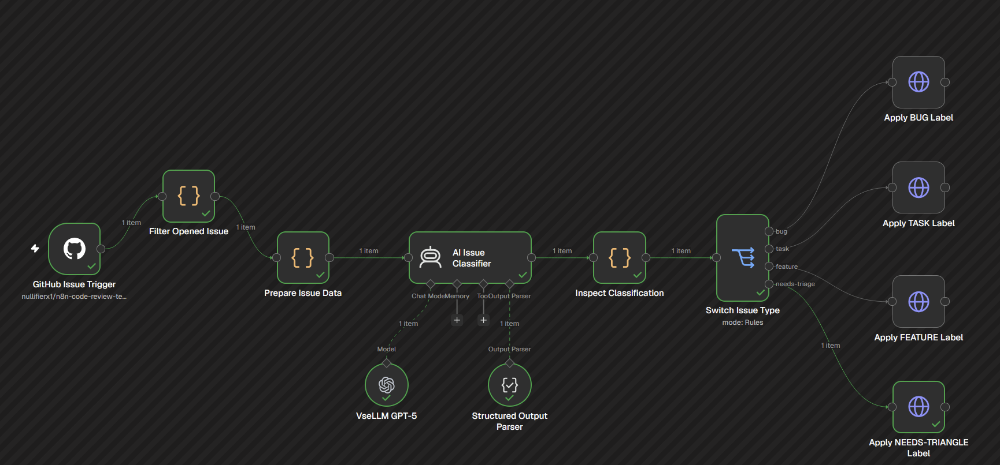
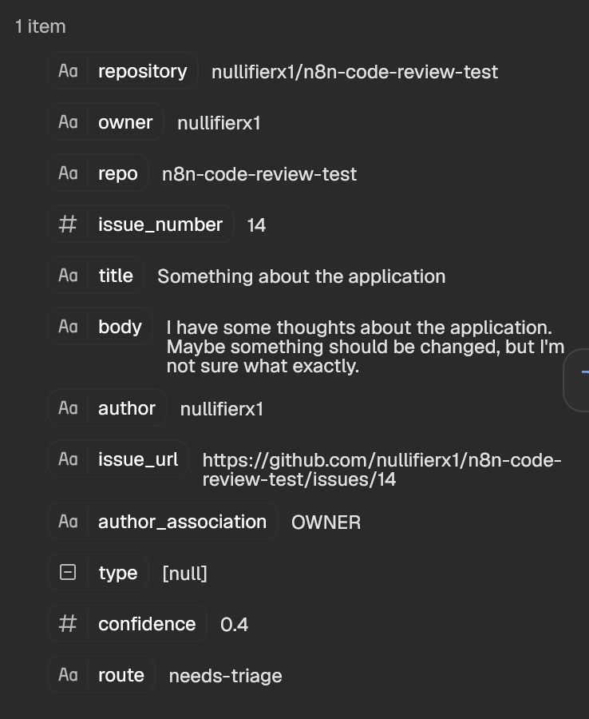
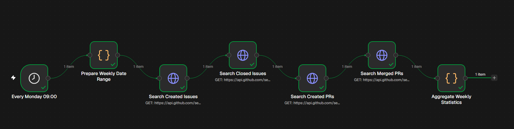
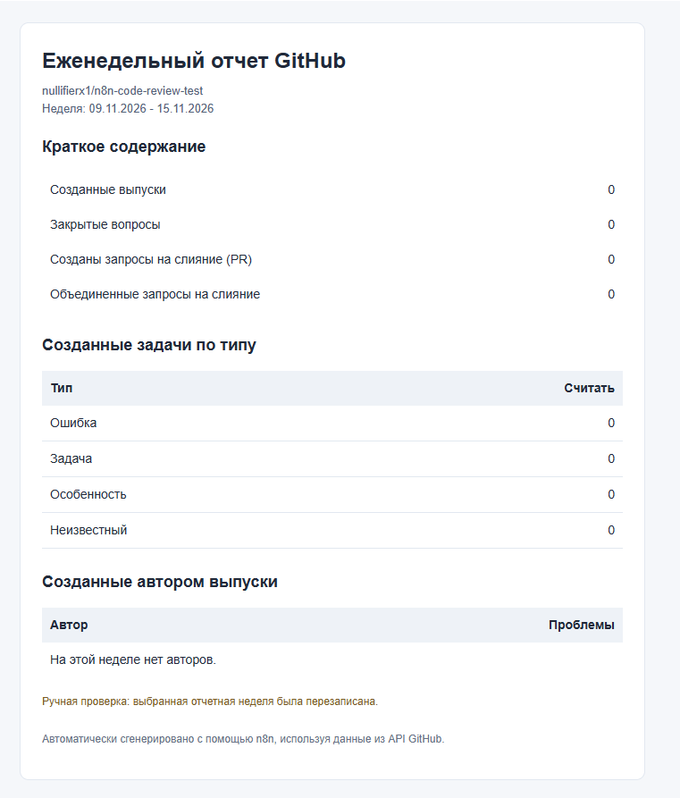
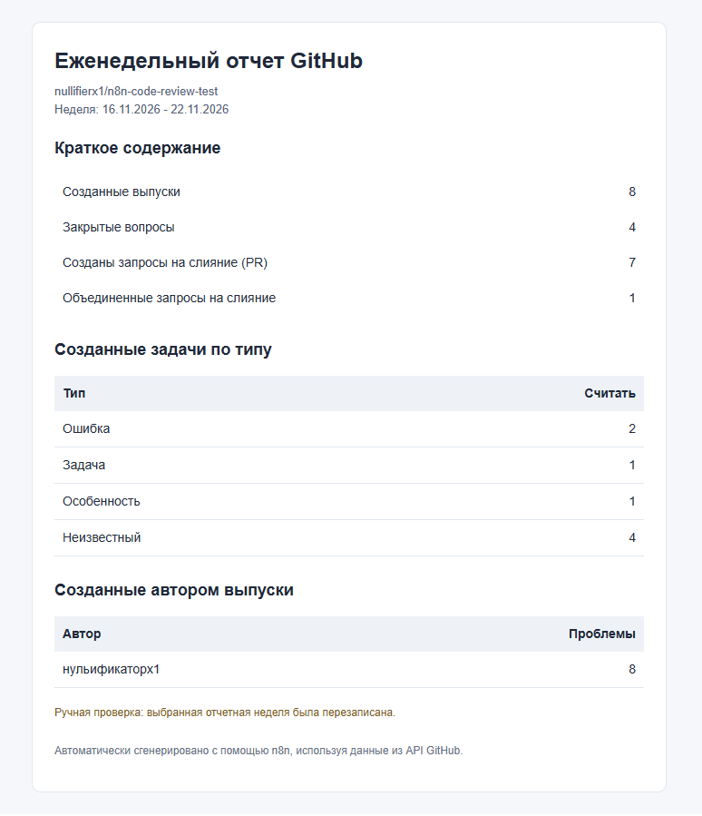
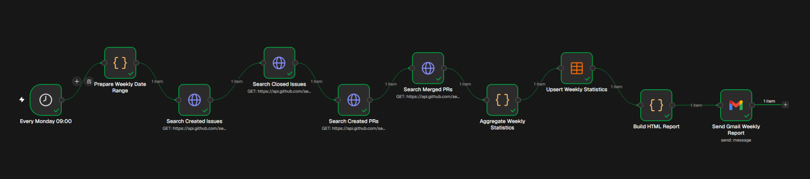
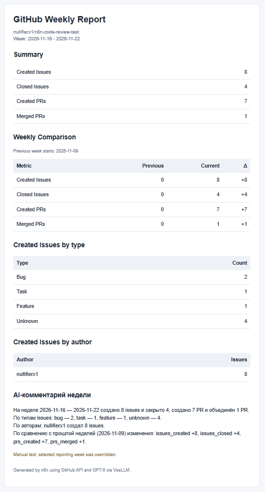
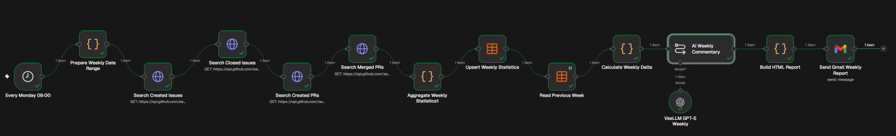
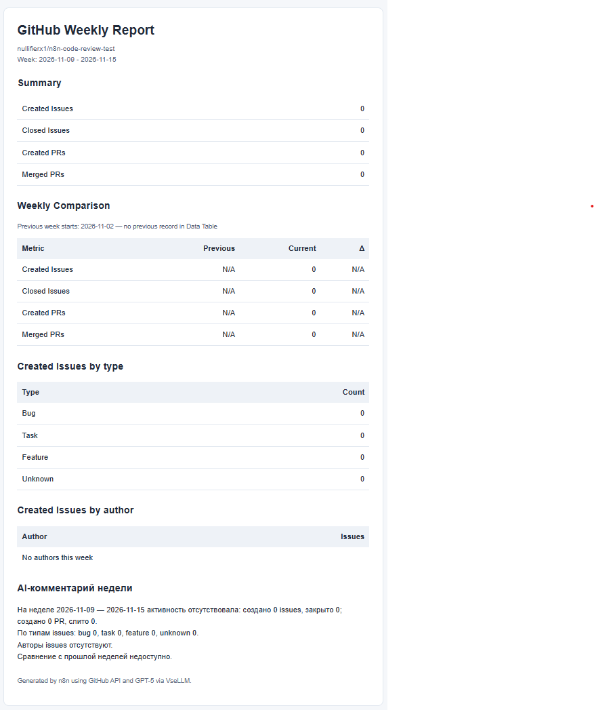

# Практика 7.2. Поддержка пользователя с помощью AI-инструментов

> Приложены три JSON-экспорта n8n, результаты классификации Issues и недельные отчёты за 9–15 и 16–22 ноября 2026 года.

## 1. Цель работы

Настроить в n8n два процесса: назначать лейблы новым GitHub Issues и отправлять недельную сводку через Gmail. Для задания со звёздочкой нужно сохранять сводки в Data Table, сравнивать две недели и добавлять в письмо комментарий модели.

Задание описано в [README](README.md) и [презентации](presentation.pdf) (страницы 13–24).

**Тестовый репозиторий:** https://github.com/nullifierx1/n8n-code-review-test

Ссылки на три сценария собраны в [LINKS.md](artifacts/LINKS.md).

## 2. Используемые инструменты

- **n8n:** выполнение автоматизаций, триггеры, HTTP Request, Data Table, Gmail.
- **GitHub API:** события открытия Issues, присвоение лейблов, выборка недельной статистики.
- **GPT-5 через VseLLM:** классификация Issues и генерация комментария к недельному отчёту.
- **Structured Output Parser:** формат `type` и `confidence`.
- **Gmail OAuth2:** отправка HTML-писем.

В классификаторе и недельной сводке настроена модель `openai/gpt-5` через VseLLM.

## 3. Архитектура

В n8n три сценария. Обработчик Issues вызывает дочерний классификатор, недельный отчёт запускается отдельно.

1. [GitHub Issue Handler](artifacts/workflow-json/github-issue-handler.json) принимает события `issues`. `Filter Opened Issue` оставляет только действие `opened`. После ответа классификатора `Switch Issue Type` выбирает ветку, которая отправляет лейбл через GitHub API.
2. [AI Issue Classifier](artifacts/workflow-json/ai-issue-classifier-subworkflow.json) принимает `title` и `body` через Execute Workflow Trigger. Structured Output Parser проверяет формат ответа GPT-5, а `Return Classification` возвращает `type` и `confidence`.
3. [Weekly GitHub Report](artifacts/workflow-json/weekly-gh-report.json) собирает статистику четырьмя запросами, сохраняет её в Data Table, читает прошлую неделю, рассчитывает Δ и отправляет HTML-письмо с комментарием модели.

## 4. Workflow 1: классификация Issues

### 4.1. Классификация и назначение лейблов

При создании Issue основной workflow считывает заголовок и описание, передаёт их в классификатор, получает категорию `bug` / `task` / `feature` и `confidence`, затем назначает соответствующий лейбл через GitHub API.

### Примеры Issues

| Issue | Результат |
|---|---|
| [#12](https://github.com/nullifierx1/n8n-code-review-test/issues/12) | `task` |
| [#13](https://github.com/nullifierx1/n8n-code-review-test/issues/13) | `feature` |
| [#14](https://github.com/nullifierx1/n8n-code-review-test/issues/14) | `needs-triage` |
| [#15](https://github.com/nullifierx1/n8n-code-review-test/issues/15) | `bug`, через sub-workflow |

Лейблы всех четырёх Issues видны на [общем снимке GitHub](artifacts/evidence/06-subworkflow-result-github.png) и на страницах Issues. На двух снимках ниже классификатор ещё находится в основном сценарии.

### 4.2. Неоднозначные обращения

Если `type = null` или `confidence < 0.8`, `Inspect Classification` направляет Issue в ветку `needs-triage`.

В [Execution №6571](https://n8n-itmo.cyrweb.ru/workflow/yTltwc4yngz4fUE0/executions/6571) для [Issue №14](https://github.com/nullifierx1/n8n-code-review-test/issues/14) в Output `Inspect Classification` видны `type = null`, `confidence = 0.4` и `route = needs-triage`. Сценарий успешно назначил лейбл, список комментариев к Issue пуст. На момент запуска классификатор ещё находился в основном workflow. Его вынесли в отдельный сценарий позднее.

### 4.3. Вызов дочернего workflow

В основном `GitHub Issue Handler` нода `Execute AI Classifier Subworkflow` передаёт `title` и `body` в `Practice 7.2 - AI Issue Classifier` и ждёт ответ с `type` и `confidence`. После ответа `Inspect Classification` определяет маршрут, а `Switch Issue Type` передаёт Issue в ноду GitHub API, которая назначает лейбл.

После выноса классификатора проверили все четыре маршрута. На снимках видны успешный вызов дочернего workflow и выполнение нод до назначения соответствующего лейбла.

| Маршрут | Тест | Доказательство |
|---|---|---|
| `bug` | [Issue №15](https://github.com/nullifierx1/n8n-code-review-test/issues/15) | [Скриншот запуска](artifacts/evidence/05-subworkflow-call-execution.png) |
| `task` | [Execution №7350](https://n8n-itmo.cyrweb.ru/workflow/YoPXV2yTeaIXktu6/executions/7350) | [Скриншот](artifacts/evidence/24-execution-7350-subworkflow-task.png) |
| `feature` | [Execution №7353](https://n8n-itmo.cyrweb.ru/workflow/YoPXV2yTeaIXktu6/executions/7353) | [Скриншот](artifacts/evidence/25-execution-7353-subworkflow-feature.png) |
| `needs-triage` | [Execution №7355](https://n8n-itmo.cyrweb.ru/workflow/YoPXV2yTeaIXktu6/executions/7355) | [Скриншот](artifacts/evidence/26-execution-7355-subworkflow-needs-triage.png) |

Execution №6571 из раздела 4.2 относится к ранней версии со встроенным классификатором. На снимках новых запусков видны маршруты, а числовые значения `confidence` в кадр не попали.

## 5. Еженедельный GitHub Report

### 5.1. Расписание и данные GitHub

В `Every Monday 09:00` задан Cron `0 9 * * MON`. Часовой пояс расписания в экспорте не указан. `Prepare Weekly Date Range` вычисляет границы в UTC от понедельника 00:00 до следующего понедельника 00:00, правая граница исключена. Четыре HTTP Request запрашивают созданные и закрытые Issues, созданные и объединённые PR. В итоговом JSON `manualWeekStart = ''`.

### 5.2. Две тестовые недели

Обе недели проверили вручную. В письме за 16–22 ноября видна пометка о ручной подстановке даты.

| Показатель | 09.11–15.11.2026 | 16.11–22.11.2026 |
|---|---:|---:|
| Создано Issues | 0 | 8 |
| Закрыто Issues | 0 | 4 |
| Создано PR | 0 | 7 |
| Объединено PR | 0 | 1 |

`Aggregate Weekly Statistics1` группирует созданные Issues по лейблам и авторам. За 16–22 ноября `nullifierx1` открыл все восемь Issues. Из них два `bug`, одно `task`, одно `feature` и четыре `unknown`. Разбивка видна в письме. Отдельного снимка Output ноды в материалах нет.

**Письмо за неделю 9–15 ноября:**

**Письмо за неделю 16–22 ноября:**

### 5.3. Data Table и предотвращение дубликатов

Таблица `weekly_issue_stats` хранит недельные значения и разбивку по типам и авторам. `Upsert Weekly Statistics` находит запись по `report_key` вида `owner/repo#YYYY-MM-DD`, где дата соответствует понедельнику. Повторный запуск обновляет существующую запись за эту неделю.

### 5.4. Сравнение недель (Δ)

`Read Previous Week` читает строку с ключом предыдущего понедельника из `weekly_issue_stats`. `Calculate Weekly Delta` вычитает сохранённые показатели из текущих, а `Build HTML Report` показывает разницу в письме.

| Показатель | Предыдущая | Текущая | Δ |
|---|---:|---:|---:|
| Создано Issues | 0 | 8 | +8 |
| Закрыто Issues | 0 | 4 | +4 |
| Создано PR | 0 | 7 | +7 |
| Объединено PR | 0 | 1 | +1 |

### 5.5. AI-комментарий недели

`AI Weekly Commentary` (Basic LLM Chain) передаёт GPT-5 через VseLLM текущие и прошлые показатели, разбивку и Δ. В письме модель кратко пересказывает статистику недели и отмечает изменения. `Build HTML Report` вставляет ответ в письмо, а `Send Gmail Weekly Report` отправляет его через Gmail. Перед запуском импортированного сценария укажите свой адрес получателя в `Send Gmail Weekly Report`.

Отдельный тест за 9–15 ноября показывает `N/A`, когда строки за предыдущую неделю нет.

## 6. Проверка критериев

| Критерий README | Баллы | Что видно в материалах |
|---|---:|---|
| Лейблы `bug`, `task`, `feature` | 2 | [Лейблы на GitHub](artifacts/evidence/06-subworkflow-result-github.png), Executions для [bug](artifacts/evidence/01-bug-label-execution.png) и [task](artifacts/evidence/02-task-label-execution.png). |
| `needs-triage` при `confidence < 0.8` | 1 | [Execution №6571](https://n8n-itmo.cyrweb.ru/workflow/yTltwc4yngz4fUE0/executions/6571) до рефакторинга. [Output](artifacts/evidence/23-execution-6571-inspect-classification-output.png) показывает `type = null` и `confidence = 0.4`, [ветка](artifacts/evidence/22-execution-6571-needs-triage-route.png) успешно назначила лейбл [Issue №14](https://github.com/nullifierx1/n8n-code-review-test/issues/14) без комментария. |
| Вызов классификатора через Execute Workflow | 2 | После выноса классификатора успешно прошли все четыре маршрута. [Запуски и скриншоты](#43-вызов-дочернего-workflow). |
| Cron и четыре запроса | 2 | [Cron в JSON](artifacts/workflow-json/weekly-gh-report.json) и [успешный ручной Execution](artifacts/evidence/07-weekly-four-api-execution.png). |
| Группировка по типу и автору | 2 | [Execution агрегации](artifacts/evidence/07-weekly-four-api-execution.png) и [разбивка в письме](artifacts/evidence/21-final-ai-report-with-delta.png). |
| HTML-письмо через Gmail | 2 | [Успешная нода Gmail](artifacts/evidence/19-final-ai-workflow-execution.png) и [снимок тела письма](artifacts/evidence/21-final-ai-report-with-delta.png). |
| Запись в Data Table | 1 | [Execution Upsert](artifacts/evidence/17-upsert-execution.png) и [две строки таблицы](artifacts/evidence/18-weekly-data-table-two-rows.png). |
| Δ по предыдущей неделе из Data Table | 2 | [Чтение и расчёт в Execution](artifacts/evidence/19-final-ai-workflow-execution.png), [Δ в письме](artifacts/evidence/21-final-ai-report-with-delta.png). |
| AI-комментарий недели | 2 | [Выполнение AI Weekly Commentary](artifacts/evidence/19-final-ai-workflow-execution.png) и [текст комментария в письме](artifacts/evidence/21-final-ai-report-with-delta.png). |
| **Максимум по README** | **16** | Критерии засчитываются по порядку. |

`first-time-contributor` и `processed_issues` показаны на занятии. В таблице оценки README на 16 баллов отдельных критериев для них нет.

## 7. Результаты и выводы

На ручных запусках получились два варианта письма. За 9–15 ноября без предыдущей строки выводится `N/A`. Для 16–22 ноября предыдущая строка есть, поэтому в письме и комментарии модели видны четыре рассчитанных Δ.

## 8. Перед сдачей

- Если сохранились данные вызова `Execute AI Classifier Subworkflow` для Issue №15, можно приложить Input с `title` и `body` и Output с `type` и `confidence`.
- Если сохранились отдельные Outputs финального недельного запуска за 16–22 ноября, приложить `Aggregate Weekly Statistics1` (счётчики, `by_type`, `by_author`), `Read Previous Week` (строка за 9–15 ноября), `Calculate Weekly Delta` (`previous`, `delta`) и Input/Output `AI Weekly Commentary` (статистика, Δ и текст).
